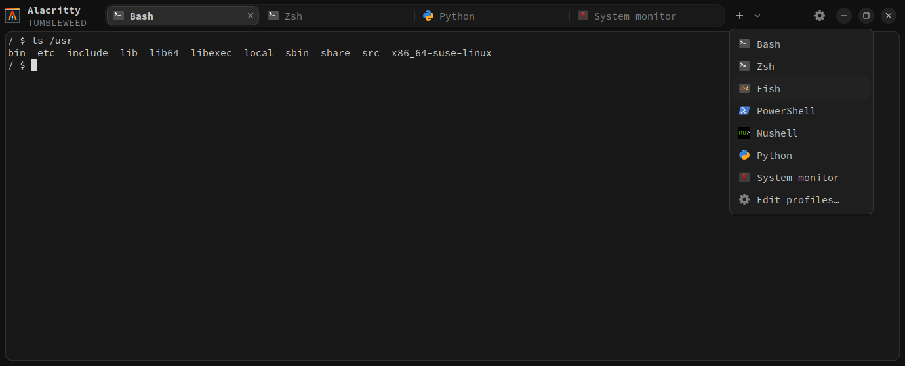
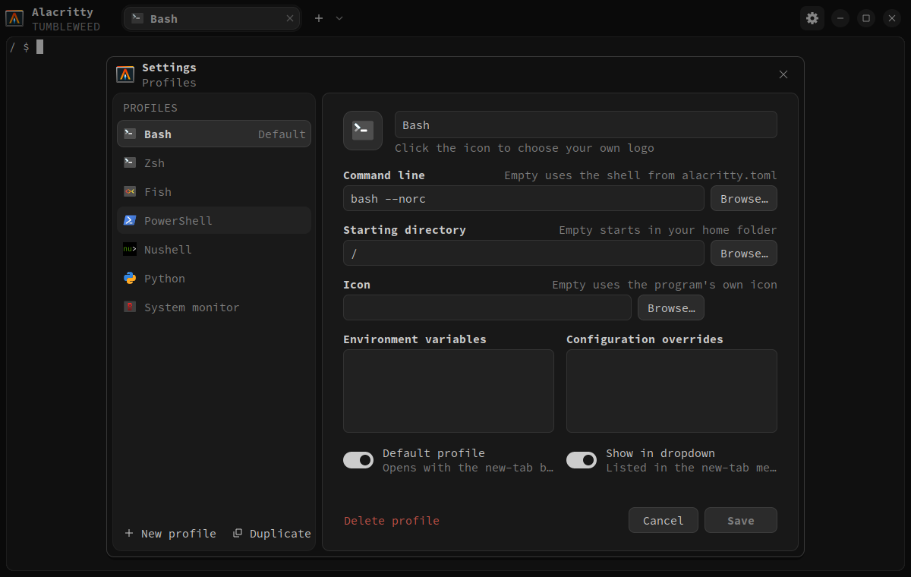

<p align="center">
    
</p>

# Alacritty Tabbed

Alacritty Tabbed ([`alacritty-tabbed`](https://github.com/Mano-Liaoyan/alacritty-tabbed))
is a soft fork of [Alacritty](https://github.com/alacritty/alacritty) that adds
tabs, shell profiles and a settings panel on Windows, Linux and macOS. It is not
an official Alacritty release. Upstream's own README is in [README.md](../README.md).



## Features

**Tabs in the caption.** The tab bar replaces the window's title bar: the logo
and computer name, the tabs on a rounded track, the + button with its profile
menu, settings, and the window controls share one row, and the terminal sits in
a rounded panel below it. Drag the empty bar to move the window, double-click it
to maximize, right-click it for the system menu (Windows and Wayland), and drag
the edges to resize. Fullscreen keeps the bar and lays out the panes as when
maximized: the panel, the gap between panes and the rounded cards all stay.
The layout is the same everywhere; the window controls take each system's look:
flat buttons on Windows, round ones on Linux, and the red, yellow and green
lights on macOS. On macOS, right-click the Dock icon for a new window.

**Tabs.** Each tab is a full Alacritty terminal with its own PTY and state;
the tabs of a window share its renderer. Drag tabs to reorder them, close them
with × or a middle click, and scroll over the bar to switch.

**Tab groups.** A tab can hold several terminals, its panes, split side by side
or stacked, like tmux's windows. Each pane is its own terminal with its own
profile; panes in the background keep running and drawing. The focused pane has
a lit border, and a grouped tab shows its panes' logos stacked like cards, the
focused one in front. Groups have no size limit: up to five panes show as
cards, and past five the stack shows five cards and a "+N" count.

- **Group** tabs by dragging one onto the middle of another, or of a group.
- **Split** by dragging a tab into the terminal: it docks beside the pane under
  the pointer, on the side nearest it, which decides between side by side and
  stacked; a preview shows where it will land. A group dragged there docks as it
  is. The tab dragged is shown while it is pressed, so pick the tab to dock into
  first.
- **Rearrange** by dragging a pane's logo from its tab's stack, the ••• grip
  of its controls, or anywhere on a pane with Ctrl+Alt held (⌘⌥ on macOS;
  plain Ctrl+drag still selects a block): into the terminal to dock it beside
  another pane, onto another tab to move it there, or between tabs to make it a
  tab of its own again. Merging is refused when a pane would get too small.
- **Tear off** a tab or a pane by dropping it outside the window: it opens in a
  new window and keeps running. "Move … to New Window" in the menus does the
  same.
- **Resize** by dragging the divider between two panes; double-click it to go
  back to half and half. Ctrl+Shift+Z (Cmd+Shift+Enter on macOS), "Zoom
  Pane" or the zoom button of a pane's controls zooms the pane to the whole tab
  and back.
- **Pane controls** appear at the top of a pane, just inside it, all together
  when the pointer comes near any of them (and on every pane while Ctrl+Alt is
  held): in the middle the ••• grip to drag it and a zoom button, which turns
  into an unzoom button in the same place while the pane is zoomed, and in the
  top right corner × to close it. They sit flat on the pane and light up only
  under the pointer, × in the red of the window's close button. While a program
  other than the shell runs in the pane, × asks first (Enter closes, Escape
  keeps it). On Windows that is any process the shell started; programs inside
  WSL or over SSH are not seen, so such panes close without asking.
- **Text size per pane:** Ctrl+mouse wheel over the focused pane, or Ctrl+= /
  Ctrl+− / Ctrl+0 (⌘ instead of Ctrl on macOS), makes only that pane's text
  larger or smaller, from half to four times its size, with a short "120 %"
  sign. The size stays with the pane while it lives, also when torn off, but is
  never saved to the profile or `alacritty.toml`. Ctrl+0 (⌘0) or "Reset Text
  Size" in the pane's menu goes back.
- **Hover** a tab's stack to fan its logos out; large groups wrap into a shelf
  below the bar. Resting on a logo shows its pane's own title, and for a pane
  that is not on screen a live preview of it. Click a logo to focus its pane.
- **Right-click** a pane for its menu: Split Vertically (side by side), Split
  Horizontally (stacked), Zoom Pane, Reset Text Size (when its text is zoomed),
  Move Pane to New Tab, Move Pane to New Window and Close Pane. Arrow keys,
  Enter and Escape work. When the program in the pane takes the mouse, hold
  Shift; Ctrl+right-click still expands the selection.
- **Right-click** a tab for its menu: Rename Tab… or, for a group, Rename
  Group… (or double-click the title), Reset Name, Ungroup, Move Tab to New
  Window and Close Tab.
- Click a pane to focus it.

Under Appearance in the settings, or in `alacritty.toml`, set the space between
panes and the focused pane's border colour, which the settings pick with a
colour picker:

```toml
[tabbed]
pane_gap = 16                # Logical pixels between panes, 0 to 48.
pane_highlight = "#ff9500"   # Leave out for the terminal's blue.
```

**Pin the tab bar.** The pin left of the settings gear keeps the bar shown.
Unpinned, the panes take the whole window and the bar slides in over them when
the pointer rests at the top edge (or, in a maximized window, on the menu bar
above it), during a drag or a keyboard tab action, and slides away again once
the pointer leaves it; the terminals are not resized as it comes and goes. On
macOS the window buttons ride on the bar and are hidden while it is. The choice is saved to `alacritty.toml` for every window.

**Logo.** Under Appearance, hide the logo and names at the top left, or pick
another logo (Alacritty Tabbed's, upstream Alacritty's, none, or a bundled one) and change the two names;
`{host}` stands for the computer's name. An SVG or PNG file can be set in
`alacritty.toml`.

**Restore session.** Under General in the settings, choose whether Alacritty
reopens its windows when it starts: **Off** (the default), **Layout** (windows,
their size and place, tabs, names, splits, zoom, each pane's profile, directory
and text size) or **Layout and text** (also the last 2,000 lines of each pane).
The session is saved when the last window is closed as a window (with the other
windows closed in the two seconds before it, as on logging out) and forgotten
when the last tab or shell is closed instead. Programs are not resumed: each
pane starts a new shell in its directory, below its restored text. Only a plain
`alacritty` launch restores, without `-e`, `--working-directory`, `--hold` or
daemon mode. The saved text may hold secrets you typed: it stays on this
computer, readable only by you on Linux and macOS, in
`$XDG_STATE_HOME/alacritty/session.json` (`~/.local/state/alacritty/` by
default; `%LOCALAPPDATA%\alacritty\session.json` on Windows), and is deleted
once restored.

```toml
[tabbed]
restore_session = "off"  # "off", "layout" or "text" (layout and text).
pin_tab_bar = true       # false: the tab bar slides in at the top edge.
wheel_zoom = true        # Ctrl+wheel (Cmd+wheel on macOS) zooms the focused pane's text.

[tabbed.brand]
show = true              # The logo and names at the top left of the tab bar.
icon = "tabbed"          # "tabbed", "alacritty" (upstream's), "" (none), "bundled:<name>" or an .svg/.png path.
title = "Alacritty"      # "" hides the line.
subtitle = "{host}"      # {host} is the computer's name; "" hides the line.
```

Panes slide and pop into place with Hyprland-like curves. Set
`ALACRITTY_ANIMATION_SCALE` to slow them down (`4` is four times slower) or to
`0` to turn them off.

**Profiles with logos.** Tabs, the ⌄ menu beside + and the settings show each
profile's logo, drawn sharp at the screen's scale: the executable's largest icon
on Windows, with each WSL distribution's own artwork and Git Bash's logo; the
icon theme's logo on Linux, preferring SVG; the application's icon on macOS.
About 40 common shells, tools, languages and WSL distributions have bundled
logos where the system has none, and other programs get a terminal. A profile
can set its own SVG or PNG, or an emoji. In a tab of several panes the logos lie
on tiles; turn off **Icon tiles** under Appearance, or in `alacritty.toml`, to
draw them bare and as large as the tiles:

```toml
[tabbed]
icon_tiles = true  # false: no tile behind the logos in a tab's deck.
```

**Settings panel.** Like Windows Terminal's, the settings list the
application's pages above the profiles, each page in titled groups of rows. They
cover every option of `alacritty(5)` that holds a value, grouped as the terminal
settings of VS Code and Zed are:

| Page | Sections |
| --- | --- |
| General | Startup (session restore, startup mode, window size and position, working directory), Behaviour (pinned tab bar, Ctrl+wheel text zoom, programs setting titles), Configuration (live reload, IPC socket, imports), Environment |
| Window | Window (title, class, level, decorations and their theme, resizing by cells), Background (opacity, blur, see-through cell colors), Padding |
| Appearance | The fork's look: Shape (corners, terminal panel, pane gap, focus highlight), Interface (font and size, tab track, icon tiles), Logo |
| Font | Font (family, style, size), Styles (bold, italic, bold italic), Spacing (cell spacing, glyph offset), Rendering (box drawing, bold in bright colors) |
| Colors | Primary, the normal, bright and dim palettes, cursor and selection, search and hints, the line indicator and footer bar |
| Cursor | Shape, blinking, thickness and hollow outline, blink interval and timeout, the vi mode's style |
| Terminal | Shell, Scrolling, Selection (copy on select, word separators, OSC 52), Mouse and keyboard (hiding the pointer, Option as Alt on macOS, hint keys), Bell |
| Advanced | Rendering (renderer, EGL, render timer, damage), Logging |

Switches, segmented choices, menus for longer lists of choices, number fields
with steppers, and color wells with a picker edit them; options that work only
on some systems are shown only there. Key and mouse bindings, hint rules and
indexed colors are lists of their own and are still edited in the file.

`alacritty.toml` stays the source of truth: the pages show the configuration as
loaded, and saving writes only the keys that changed, under Alacritty's own
names (`font.size`, `cursor.style.shape`, `colors.normal.red` and so on, or
`[tabbed]` for the fork's), keeping the file's comments and its tables' forms,
and applies them to every window. Emptying a text, a color or an optional number
removes its key, for the default.

"Edit profiles…" in the ⌄ menu opens the profiles: name, icon, command line,
starting directory, font, environment variables, configuration overrides, the
default profile, and whether a profile shows in the menu. The font field lists
the system's monospaced fonts as you type; "Show all fonts" lists every font.
Clicking the profile's icon picks one of the bundled logos, and Browse picks
your own. Saved changes apply to the tabs already open with a profile. Browse
buttons use the system's file pickers. Profiles can be added, duplicated,
deleted, and dragged to reorder them. They are saved to `profiles.toml` beside
`alacritty.toml`, which can also be edited by hand.



**Interface font.** The bar, its menus and the settings use a proportional
interface font of their own, apart from the terminal's font: the system's
interface font on macOS (San Francisco, else Helvetica Neue) and Windows
(Segoe UI), and on Linux the first installed of Inter, Adwaita Sans, Noto Sans
and other common interface fonts. Emphasized text uses the family's SemiBold or
Medium face when it has one. Choose another family or size under Appearance in
the settings, or in `alacritty.toml`; changes apply live:

```toml
[tabbed.ui_font]
family = "Inter"  # Empty picks the system's interface font.
size = 10         # Points; the default is 10, or 13 on macOS.
```

**Corners.** The window, the terminal's panel, the tab track, the tabs, the
buttons and the settings are all rounded, with radii that nest: each surface
inside another is rounded by the outer radius less the space between them, so
their curves run parallel. Or make every corner square, under Appearance in the
settings or in `alacritty.toml`; changes apply live:

```toml
[tabbed]
corners = "square"  # "round" (default) or "square".
```

On Linux, round window corners are cut out of the window, which needs a
compositor; without one, choose square corners. Windows rounds the window
itself, and macOS always does.

## Disable

Tabs are on by default. To turn them off:

```toml
[tabbed]
tabs = false
```

Restart Alacritty after changing `tabbed.tabs`.

## Configuration

The fork's keys live in a `[tabbed]` table of their own, apart from upstream's
tables: `tabs`, `corners`, `panel`, `tab_track`, `icon_tiles`, `pane_gap`,
`pane_highlight`, `pin_tab_bar`, `wheel_zoom`, `restore_session`, and the
`[tabbed.ui_font]` and `[tabbed.brand]` tables.

Earlier versions read these keys from `[window]` (and `[window.ui_font]`,
`[window.brand]`); there they are now ignored, with an "Unused config key"
warning. Saving the settings moves them to `[tabbed]`, keeping their comments,
or rename the tables by hand:

```toml
[window]
startup_mode = "Maximized"  # Upstream keys stay in [window].

[tabbed]                    # Was [window].
pane_gap = 6

[tabbed.brand]              # Was [window.brand].
show = false
```

| Keys (Windows, Linux) | macOS | Action |
| --- | --- | --- |
| Ctrl+Shift+T, + | Cmd+T, + | New tab with the default profile |
| ⌄ beside + | ⌄ beside + | Choose a profile (arrow keys and Enter work) |
| Ctrl+Tab / Ctrl+Shift+Tab | Cmd+Shift+] / Cmd+Shift+[ | Next / previous tab |
| Ctrl+1 to Ctrl+8, Ctrl+9 | Cmd+1 to Cmd+8, Cmd+9 | Select a tab, or the last tab |
| Ctrl+Shift+W | Cmd+W | Close the focused pane, or its tab when it is the only one |
| ×, middle click | ×, middle click | Close a tab with all its panes |
| Right click in a pane | Right click in a pane | Split, zoom, move or close the pane |
| Ctrl+Shift+Z | Cmd+Shift+Enter | Zoom the focused pane, or unzoom |
| Right click a tab | Right click a tab | Rename, ungroup, move or close the tab |
| Ctrl+Shift+U (Windows) | | New tab with the default WSL distribution |
| F11 | Ctrl+Cmd+F | Toggle fullscreen |

Keys bound in `keyboard.bindings` keep their meaning, and the `CreateNewTab`,
`SelectNextTab`, `SelectPreviousTab`, `SelectTab1`-`SelectTab9`,
`SelectLastTab` and `TogglePaneZoom` actions work on every platform. The
window's close button closes all of its tabs.

## Profiles

Until profiles are saved, the menu offers the installed shells: PowerShell,
Windows PowerShell, Command Prompt, Git Bash and each WSL distribution on
Windows, and the shells in `/etc/shells` elsewhere. The default profile starts
the first tab of each window and every new tab.

```toml
default = "Bash"                      # Profile for new windows, + and the new-tab keys.

[[profile]]
name = "Bash"
command = "bash --login"              # Empty uses the shell from alacritty.toml.
directory = "~/projects"              # Empty starts in the home directory.
icon = "~/icons/bash.png"             # An image, a bundled logo such as "bundled:python", or text
                                      # such as "🐧"; empty uses the program's icon.
font = "JetBrains Mono"               # Font family; empty uses the font from alacritty.toml.
env = { EDITOR = "vim" }
options = ["font.size=14"]            # Configuration overrides for this profile's tabs.
hidden = false                        # Leave out of the menu.
```

Icons can be SVG and PNG files everywhere, `.ico`, `.exe` and `.dll` files on
Windows, and `.icns` files or application bundles on macOS. On Linux, logos come
from the profile program's desktop entry or are named after it, in the icon
theme set for KDE or GTK, the themes it inherits, and `hicolor`. The bundled
logos, from devicon, Simple Icons and the projects' own repositories, are listed
with their licences in [`alacritty/res/icons/LICENSES.md`](../alacritty/res/icons/LICENSES.md).

### Splits start in the pane's directory

A split runs the pane's profile in the directory its shell is in. The shell can
report it with `OSC 7` (`ESC ] 7 ; file://host/path ST`) or Windows Terminal's
`OSC 9 ; 9` (`ESC ] 9 ; 9 ; "C:\path" ST`); the latest report wins. Otherwise:

- **Linux, macOS, BSD**: the directory of the program in the foreground,
  without any setup; a report is used only when that cannot be read.
- **Command Prompt, Git Bash** (and other MSYS or Cygwin shells): read from the
  shell's process, without any setup.
- **PowerShell, Windows PowerShell**: `Set-Location` does not change the
  process's directory, so the prompt has to report it. Marking the pane does
  not help here: the process is found, but its directory is not the location.
- **WSL**: without any setup. Each pane carries an `ALACRITTY_PANE_ID`, which
  `WSLENV` passes into Linux; a split runs a short `wsl.exe -e sh` that finds
  the pane's processes in `/proc` and reads the directory of the one in the
  foreground, or else of the shell, giving up after 1.5 seconds. The split
  starts `wsl.exe` with `--cd <path>`, `/mnt/c/…` included, or, for paths with
  spaces, in the path's `\\wsl.localhost\<distribution>\…` folder, which WSL
  translates; without `-d <distribution>` in the profile, those start at home.
  Windows paths such as `/mnt/c/…`, `/c/…` or `C:\…` in a report work for every
  profile.

A report from another host, such as a shell over SSH, or of a directory that
does not exist here, is ignored. Only PowerShell needs setup, but other shells
can report too, and a report comes before what is read from processes on
Windows. One line in the shell's startup file reports the directory at each
prompt:

```sh
# bash, ~/.bashrc
PROMPT_COMMAND='printf "\e]7;file://%s%s\a" "$HOSTNAME" "$PWD"'${PROMPT_COMMAND:+";$PROMPT_COMMAND"}
# zsh, ~/.zshrc
autoload -Uz add-zsh-hook; _osc7() { printf '\e]7;file://%s%s\a' "$HOST" "$PWD" }; add-zsh-hook precmd _osc7
# fish, ~/.config/fish/config.fish (recent versions already report it)
function _osc7 --on-variable PWD; printf '\e]7;file://%s%s\a' $hostname $PWD; end
```

```powershell
# PowerShell and Windows PowerShell, $PROFILE
$function:_prompt = $function:prompt; function prompt { $l = $executionContext.SessionState.Path.CurrentLocation; $(if ($l.Provider.Name -eq 'FileSystem') { "$([char]27)]9;9;`"$($l.ProviderPath)`"$([char]27)\" }) + (_prompt) }
```

With [Oh My Posh](https://ohmyposh.dev), set `pwd = "osc7"` in its
configuration instead.

## Syncing with upstream

The fork keeps its changes to upstream's files small, so that merging upstream
stays cheap; the rules are in [CLAUDE.md](../CLAUDE.md). The
[Upstream sync](workflows/upstream-sync.yml) workflow tries the merge weekly and
opens an issue when it conflicts.

## Alacritty

Everything else, from installation to configuration, is as in Alacritty
itself: see upstream's [README.md](../README.md), [INSTALL.md](../INSTALL.md)
and [CONTRIBUTING.md](../CONTRIBUTING.md).

The differences are the logo and the name. Where INSTALL.md installs
`extra/logo/alacritty-term.svg` as the desktop icon, install
[`extra/logo/tabbed/alacritty-tabbed.svg`](../extra/logo/tabbed/alacritty-tabbed.svg)
instead. The Windows and macOS builds already carry it. On macOS, `make app`
builds `target/release/osx/Alacritty Tabbed.app`, rather than `Alacritty.app`,
which the menu bar and the Dock name Alacritty Tabbed; copy it to
`/Applications` under that name. It keeps upstream's bundle identifier,
`org.alacritty`, and so its preferences and the permissions granted to it.
