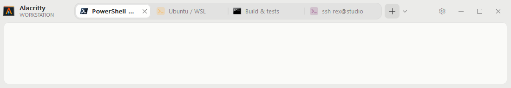

# Alacritty Tabbed

Alacritty Tabbed ([`alacritty-tabbed`](https://github.com/Mano-Liaoyan/alacritty-tabbed))
is a soft fork of [Alacritty](https://github.com/alacritty/alacritty) that
adds native tabs, shell profiles, and a settings panel on Windows. It tracks
upstream: the `main` branch is an upstream release (currently v0.17.0) plus the
Windows tabs work, and `master` mirrors upstream for syncing. It is not an
official Alacritty release. Upstream's README follows the fork notes below.

Each tab is a full Alacritty terminal, with its own OpenGL surface, PTY, and
terminal state, hosted in one top-level window. No new crates or UI framework
are added: the header, dropdown, and settings panel are plain Win32 drawn with
the existing `windows-sys` bindings. Other platforms are unchanged.


[Watch the demo as MP4](docs/windows-tabs/demo.mp4)

## Features

**Integrated tab header.** Tabs, the + button, a profile dropdown, settings, and
the window controls share one row in place of the native caption. Drag tabs
sideways to reorder them.

**Profiles with real icons.** The dropdown beside + lists PowerShell 7, Windows
PowerShell, Command Prompt, Git Bash, and every registered WSL distribution,
each with the program's or distribution's own icon.

**Settings panel.** The gear opens per-profile settings: name, icon, command
line, starting directory, environment variables, and Alacritty configuration
overrides (such as `font.size=14`), plus the default profile and dropdown
visibility. Duplicate profiles and drag them in the sidebar to reorder them.
Profiles are saved to `%APPDATA%\alacritty\profiles.toml`.

**Fullscreen keeps the tabs.** F11 or Alt+Enter goes fullscreen with the header
still visible and the terminal edge to edge below it.

**Light and dark themes.** Header colors come from your configured color
scheme. Narrow windows get overflow arrows.



## Enable

```toml
[window]
tabs = true
```

`window.tabs` is Windows-only, defaults to `false`, and needs a restart to
change.

| Keys | Action |
| --- | --- |
| Ctrl+Shift+T | New tab with the default profile |
| Ctrl+Shift+U | New tab with the default WSL distribution |
| Ctrl+Tab / Ctrl+Shift+Tab | Next / previous tab |
| Ctrl+1 to Ctrl+8, Ctrl+9 | Select a tab, or the last tab |
| Ctrl+Shift+W, middle click | Close a tab |
| F11, Alt+Enter | Toggle fullscreen |

Bindings can be changed with `keyboard.bindings`. See
[WINDOWS_TABS.md](WINDOWS_TABS.md) for all controls, profile settings, the
implementation, and known limits.

## Build

Building needs Rust 1.85+ with the MSVC toolchain and the Visual Studio C++ build
tools.

```powershell
git clone https://github.com/Mano-Liaoyan/alacritty-tabbed.git
cd alacritty-tabbed
cargo build --release --locked --no-default-features -p alacritty
```

The executable is `target/release/alacritty.exe`.

## Syncing with upstream

```sh
git remote add upstream https://github.com/alacritty/alacritty.git  # once
git fetch upstream --tags
git checkout main
git merge upstream/master   # or a release tag, e.g. v0.18.0
```

The fork's changes stay out of upstream files where they can, and this section
sits above upstream's README, so merges should conflict rarely.

---

<p align="center">
    
</p>

<h1 align="center">Alacritty - A fast, cross-platform, OpenGL terminal emulator</h1>

<p align="center">
  
</p>

## About

Alacritty is a modern terminal emulator that comes with sensible defaults, but
allows for extensive [configuration](#configuration). By integrating with other
applications, rather than reimplementing their functionality, it manages to
provide a flexible set of [features](./docs/features.md) with high performance.
The supported platforms currently consist of BSD, Linux, macOS and Windows.

The software is considered to be at a **beta** level of readiness; there are
a few missing features and bugs to be fixed, but it is already used by many as
a daily driver.

Precompiled binaries are available from the [GitHub releases page](https://github.com/alacritty/alacritty/releases).

Join [`#alacritty`] on libera.chat if you have questions or looking for a quick help.

[`#alacritty`]: https://web.libera.chat/gamja/?channels=#alacritty

## Features

You can find an overview over the features available in Alacritty [here](./docs/features.md).

## Further information

- [Announcing Alacritty, a GPU-Accelerated Terminal Emulator](https://jwilm.io/blog/announcing-alacritty/) January 6, 2017
- [A talk about Alacritty at the Rust Meetup January 2017](https://www.youtube.com/watch?v=qHOdYO3WUTk) January 19, 2017
- [Alacritty Lands Scrollback, Publishes Benchmarks](https://jwilm.io/blog/alacritty-lands-scrollback/) September 17, 2018

## Installation

Alacritty can be installed by using various package managers on Linux, BSD,
macOS and Windows.

Prebuilt binaries for macOS and Windows can also be downloaded from the
[GitHub releases page](https://github.com/alacritty/alacritty/releases).

For everyone else, the detailed instructions to install Alacritty can be found
[here](INSTALL.md).

### Requirements

- At least OpenGL ES 2.0
- [Windows] ConPTY support (Windows 10 version 1809 or higher)

## Configuration

You can find the documentation for Alacritty's configuration in `man 5
alacritty`, or by looking at [the website] if you do not have the manpages
installed.

[the website]: https://alacritty.org/config-alacritty.html

Alacritty doesn't create the config file for you, but it looks for one in the
following locations:

1. `$XDG_CONFIG_HOME/alacritty/alacritty.toml`
2. `$XDG_CONFIG_HOME/alacritty.toml`
3. `$HOME/.config/alacritty/alacritty.toml`
4. `$HOME/.alacritty.toml`
5. `/etc/alacritty/alacritty.toml`

On Windows, the config file will be looked for in:

* `%APPDATA%\alacritty\alacritty.toml`

## Contributing

A guideline about contributing to Alacritty can be found in the
[`CONTRIBUTING.md`](CONTRIBUTING.md) file.

## FAQ

**_Is it really the fastest terminal emulator?_**

Benchmarking terminal emulators is complicated. Alacritty uses
[vtebench](https://github.com/alacritty/vtebench) to quantify terminal emulator
throughput and manages to consistently score better than the competition using
it. If you have found an example where this is not the case, please report a
bug.

Other aspects like latency or framerate and frame consistency are more difficult
to quantify. Some terminal emulators also intentionally slow down to save
resources, which might be preferred by some users.

If you have doubts about Alacritty's performance or usability, the best way to
quantify terminal emulators is always to test them with **your** specific
usecases.

**_Why isn't feature X implemented?_**

Alacritty has many great features, but not every feature from every other
terminal. This could be for a number of reasons, but sometimes it's just not a
good fit for Alacritty. This means you won't find things like tabs or splits
(which are best left to a window manager or [terminal multiplexer][tmux]) nor
niceties like a GUI config editor.

[tmux]: https://github.com/tmux/tmux

## License

Alacritty is released under the [Apache License, Version 2.0].

[Apache License, Version 2.0]: https://github.com/alacritty/alacritty/blob/master/LICENSE-APACHE
